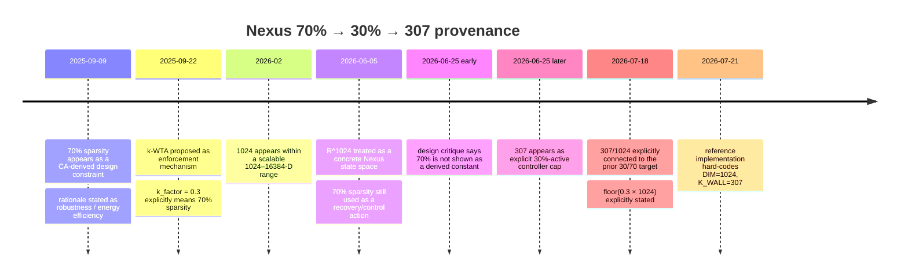
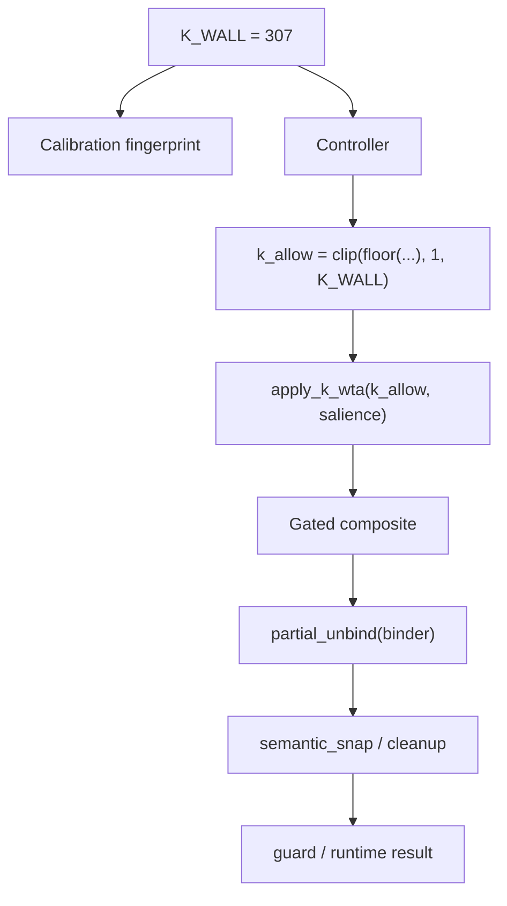

# Why 307? Capacity, Sparsity, Collision, Recoverability, and Structural Vacuum in the 1,024-D Quinary Nexus HSL

## Research options and selection

The supplied deep-research brief makes one topic unusually suitable for a rigorous end-to-end investigation because it combines historical provenance, executable code, formal mathematics, empirical testing, and comparison with primary HDC/VSA literature. fileciteturn0file0 Three research programs would showcase the same workflow:

| Domain | Research question | Key objectives | Methodology and primary data | Expected deliverables | Estimated full reproducible effort |
|---|---|---|---|---|---|
| **Technology — selected** | **What evidence should justify a fixed sparsity/occupancy cap in an HDC/VSA system, and does Nexus's \(D=1024,\ K=307\) satisfy that standard?** | Recover provenance; audit implementation; prove or disprove recoverability claims; quantify capacity, overlap, collisions, information retention, ANN implications; test nearby \(K\) values. | Nexus Drive/GitHub archaeology; revision history; executable reference code; exact combinatorics; Monte Carlo sweep; primary HDC/VSA, SDM, WTA, HRR and HNSW papers. | 20–30-page technical report; provenance and dependency diagrams; mathematical tables; sensitivity plots; benchmark notebook; source appendix. | ~18–28 analyst hours / 2–4 working days for publication-grade replication. |
| **Health** | How do efficacy, durability, discontinuation, adverse-event and weight-regain evidence compare across modern pharmacologic obesity treatments in adults? | Separate randomized efficacy from real-world effectiveness; characterize durability and harms; identify evidence gaps across populations. | Regulatory labels and reviews; trial registries; original randomized trials; extension studies; prospective cohorts; meta-analysis with explicit estimands. | 15–25-page evidence review; trial matrix; forest plots; persistence/attrition chart; certainty-of-evidence table. | ~22–32 hours / 3–5 days. |
| **Policy** | What evaluation and incident-reporting regime best balances measurable frontier-AI risk reduction, auditability, innovation cost, and enforceability? | Compare competing regulatory mechanisms; map evidence to measurable failure modes; distinguish ex-ante evaluations from post-deployment reporting. | Statutes and rulemaking records; regulator publications; standards bodies; original evaluation studies; incident databases; structured cross-jurisdiction comparison. | 20–30-page policy analysis; jurisdiction matrix; causal/evidence map; implementation options and model reporting schema. | ~24–36 hours / 3–5 days. |

**Selected topic:** the technology question. It is the most broadly useful *for the supplied research context* because the Nexus case lets us test a general problem—how fixed architectural constants acquire legitimate evidentiary status—using primary internal provenance, executable implementation, formal analysis, and independent literature rather than merely surveying published claims. The available reference artifact is a 61,198-byte `project_nexus_v4_reference_reviewed.txt` created July 21, 2026. fileciteturn25file0L3-L19

## Executive conclusion

### Why 307?

**The best-supported answer is that 307 is a historical/reference k-WTA occupancy cap obtained by taking the earlier 30%-active/70%-vacuum design target and discretizing it as \(\lfloor0.30\times1024\rfloor=307\). I found no evidence that 307 was independently discovered as a recoverability threshold, collision threshold, capacity optimum, ANN optimum, packing boundary, or mathematical constant.**

The provenance is unusually revealing:

* A **70% sparsity target predates 307 by many months** in the accessible Nexus corpus. A September 9, 2025 TMS engineering document says the “70% sparsity constraint from the CA” can be enforced for regularization and describes the intended benefits as robustness and energy efficiency; it does not derive 70% mathematically. fileciteturn15file3L28-L39 fileciteturn19file0
* By September 22, 2025, a Nexus/HTNLA plan explicitly equates `k_factor = 0.3` with **70% sparsity** and proposes k-WTA as the enforcement mechanism. fileciteturn16file0 fileciteturn16file1
* \(1024\) itself appears in the corpus first as one possible size in a **scalable range of 1024–16384 dimensions**, rather than as a demonstrated optimum; by June 5, 2026, a document treats the state space as \(\mathbb R^{1024}\). fileciteturn29file0L1-L9 fileciteturn28file0L1-L11
* A June 25 revision of the design debate **before 307 appears** explicitly criticizes the “70% thermodynamic wall” story, saying that 70% is not shown to be a derived constant and describing that explanation as post-hoc. fileciteturn23file0
* A later revision the same day introduces the explicit controller formula \(k_{\rm allow}=\min(307,\ldots)\) and describes 307 as the **30% active cap**. fileciteturn24file0
* By July 18, downstream documents make the arithmetic explicit: one says \(307/1024\approx30\%\), matching the previously stated target, while another gives \(k=\lfloor0.3\times1024\rfloor\approx307\). fileciteturn12file0L1-L5 fileciteturn12file4L30-L38
* The July 21 reference code then freezes `DIM = 1024` and `K_WALL = 307`, with the comment “<=30% retained activation, >=70% structural vacuum.” fileciteturn12file2L12-L20

That order strongly favors **“70%/30% target first → 307 derived afterward”**, not “307 experimentally discovered → 70% inferred afterward.”

The implementation reinforces that interpretation. In the current reference code, 307 is hard-coded and used by the controller to clamp its calculated `k_allow`; the representation itself can contain more than 307 active coordinates. The constructor does not reject them, packing size is unaffected by \(K\), and `apply_k_wta` itself accepts a requested \(k\) anywhere from 0 to 1024. The normal runtime reaches the cap through controller policy. fileciteturn8file2

Most importantly, **partial unbinding supplies no mathematical reason for 307**. The reference binding rule is coordinate-separable. For fixed \(c_i,r_i\), the possible values of \(q_i\) do not depend on how many other coordinates are active. Global occupancy changes how often various coordinate cases occur, but it does not change the local inverse relation, and nothing discontinuous occurs at \(K=307\).

I also executed the downloaded reference implementation's own property suite; it completed with `All Project Nexus v4.0 property tests passed.` The suite tests deterministic k-WTA at \(k=123\), not a failure boundary at 307, and source search shows `K_WALL` only in the constant definition, calibration fingerprint, and controller clipping expression. Thus the current tests demonstrate implementation behavior, **not why the threshold should be 307**. The executable artifact is the same July 21 reference file cited above. fileciteturn25file0L3-L19

The external literature points in the same direction. Sparse HDC/VSA representations can indeed have important memory, noise, or implementation advantages, but their useful sparsity depends on the representation, binding operation, cleanup memory, load, noise and decoding procedure. Frady, Kleyko and Sommer explicitly formulate sparsity as \(K/N\), analyze model-dependent sparse binding, and give recovery conditions involving \(K\), dimension and the measurement/codebook structure rather than a universal 30% ratio. citeturn6view0 Winner-take-all methods deliberately impose sparsity, but the original WTA-autoencoder work treats sparsity as a chosen learning mechanism rather than establishing a universal 30% law. citeturn7view0 Classical VSA superposition capacity is likewise governed by crosstalk, dimensionality and load. citeturn7view3

So the evidentiary classification is:

> **307 is presently a useful, deterministic reference-policy constant with historical provenance, but not a demonstrated mathematical wall or empirically established optimum.**

## Internal provenance and implementation audit

### The provenance timeline

The important finding is not merely that earlier files contain 70% and later files contain 307; it is that the documents progressively expose the transformation from a qualitative target into an integer implementation constant.

The September 2025 source describes 70% as a CA constraint and discusses it in regularization/energy terms, but does not show an optimization, theorem, benchmark curve or measured breakpoint. fileciteturn19file0 The later September plan is even more explicit operationally: it gives a k-WTA function whose `k_factor` example is 0.3 “for 70% sparsity.” fileciteturn16file1

That significantly weakens the hypothesis that 307 emerged from an experiment. In the June 25 revision history, revision 9 contains no “307” and explicitly challenges 70% as a mathematically derived wall; by revision 61 the explicit \(307\) controller cap is present. fileciteturn23file0 fileciteturn24file0 The subsequent July documents then state the arithmetic relationship rather than an independent optimization result. fileciteturn12file0L1-L5 fileciteturn12file4L30-L38

This is not proof that no still-earlier rationale exists outside the connected corpus. It is, however, strong evidence for the provenance visible today: **the percentage target is historically upstream of the exact integer**.

### Floor or round?

Exactly,

\[
0.30(1024)=307.2.
\]

Therefore

\[
\lfloor0.30(1024)\rfloor=307,
\]

while ordinary nearest-integer rounding also happens to produce 307. The decisive provenance evidence is the July 18 source that explicitly writes the operation as **floor**, not merely round. fileciteturn12file4L30-L38

The resulting exact reference fractions are

\[
p_{\rm ref}={307\over1024}=0.2998046875,
\]

and

\[
v_{\rm ref}=1-p_{\rm ref}
={717\over1024}
=0.7001953125.
\]

Thus the slight excess over 70% vacuum is a consequence of integer quantization, not evidence for a distinct 70.0195% optimum.

### What the current code actually does

The current implementation uses three packed bit planes—sign, magnitude-1 and magnitude-2—with the invariant that the two magnitude planes cannot overlap. `K_WALL` does **not** define the alphabet, bit-plane layout or validity of the quinary representation. fileciteturn8file0

Its operative dependency is:

The controller computes an affine resource budget from its control state and then clips the result to `K_WALL`; this makes 307 a **controller policy ceiling**. fileciteturn8file2 The runtime then applies deterministic salience-ranked k-WTA before partial unbinding and semantic cleanup. fileciteturn8file1

This creates an important distinction:

**Direct effect:**  
\(K_{\rm wall}\rightarrow k_{\rm allow}\rightarrow\) how many active coordinates survive global competition.

**Indirect downstream effect:**  
If k-WTA deletes an active coordinate before partial unbinding, the later inverse sees a different \(c_i\), so recovery can worsen.

**No direct algebraic effect:**  
`partial_unbind(c,r)` itself does not inspect `K_WALL`, total popcount, or occupancy elsewhere in the vector. fileciteturn8file0

That distinction resolves an apparent contradiction. It is entirely possible for global top-\(k\) pruning to affect whole-vector reconstruction while the **coordinatewise inverse relation itself remains occupancy-independent**.

### Packing and the “bit-budget” hypothesis

With \(D=1024\), `WORD_BITS=64` gives 16 machine words per plane. Three 1024-bit planes therefore contain

\[
3\times1024=3072\ {\rm bits}
=384\ {\rm raw\ bytes}.
\]

That is fixed whether a vector has 1, 307, 700 or 1024 active coordinates. The inspected representation contains no separate coordinate-list encoding whose size switches at 307. `K_WALL` is present in calibration/controller logic, not in the packing calculation. fileciteturn12file2L12-L20 fileciteturn8file2

Accordingly, the claim that 307 follows from a per-coordinate bit budget, page boundary, SIMD boundary, or packed-vector size is **unsupported by the current reference implementation**. A sparse-result policy can reduce downstream activity, but in this implementation it does not reduce the number of bits in the underlying packed HSL object.

## Mathematical capacity, overlap, collision, and recoverability

### Raw combinatorial capacity

For exactly \(K\) active coordinates and four possible nonzero symbols,

\[
N(D,K)=\binom DK4^K,
\]

so

\[
\log_2N(D,K)
=\log_2\binom DK+2K.
\]

This is only a **representation state-count calculation**; it is not a retrieval-capacity theorem.

For \(D=1024\):

| \(K\) | Occupancy | \(\log_2 N(1024,K)\) bits | Expected support overlap \(K^2/D\) |
|---:|---:|---:|---:|
| 32 | 3.13% | 265.6 | 1.0 |
| 64 | 6.25% | 469.1 | 4.0 |
| 128 | 12.50% | 807.9 | 16.0 |
| 192 | 18.75% | 1,092.0 | 36.0 |
| 256 | 25.00% | 1,337.6 | 64.0 |
| **307** | **29.98%** | **1,511.0** | **92.04** |
| 384 | 37.50% | 1,740.1 | 144.0 |
| 512 | 50.00% | 2,042.7 | 256.0 |
| 768 | 75.00% | 2,361.6 | 576.0 |
| 819 | 79.98% | 2,372.65 | 655.04 |
| 820 | 80.08% | 2,372.65 | 656.64 |
| 1024 | 100% | 2,048.0 | 1,024 |

The adjacent-shell ratio is

\[
{N(D,K+1)\over N(D,K)}
=
4{D-K\over K+1}.
\]

For \(D=1024\), it equals one at \(K=819\), making \(K=819\) and \(820\) the equal maximizing shells. **Nothing extremal happens at 307.**

The cumulative state space allowed by \(K\le307\) has

\[
\log_2\sum_{k=0}^{307}\binom{1024}{k}4^k
\approx1511.16\ {\rm bits}.
\]

The unrestricted quinary space has

\[
\log_2 5^{1024}
=1024\log_2 5
\approx2377.65\ {\rm bits}.
\]

Thus the \(\le307\) constraint retains about **63.6% of the unrestricted logarithmic raw state capacity**. Again, this says nothing by itself about semantic retrieval quality or cleanup capacity.

A related i.i.d. model with active probability \(p\) and all four nonzero values equiprobable has per-coordinate entropy

\[
H(X)=h_2(p)+2p.
\]

This is maximized at \(p=0.8\), where all five quinary symbols become equiprobable. At the Nexus reference \(p=307/1024\),

\[
H(X)\approx1.481\ {\rm bits/coordinate},
\]

not an extremum. Raw information theory therefore supplies no 30% preference.

### Support overlap

Two independent uniformly selected \(K\)-subsets have

\[
X=|A\cap B|
\sim\operatorname{Hypergeometric}(N=D,\;K,\;n=K)
\]

with

\[
E[X]={K^2\over D}
\]

and

\[
\operatorname{Var}(X)
=
K{K\over D}\left(1-{K\over D}\right)
{D-K\over D-1}.
\]

At \(D=1024,K=307\),

\[
E[X]\approx92.04,\qquad
\sigma_X\approx6.72.
\]

The probability that two supports have **zero** overlap is

\[
P(X=0)=
{\binom{D-K}{K}\over\binom DK},
\]

which at \(K=307\) is approximately

\[
1.17\times10^{-59}.
\]

So 30% occupancy is not “sparse” in the sense of making independently generated supports usually disjoint. It creates roughly 92 shared active positions per random pair. At \(K=32\), by contrast, the expected overlap is 1 and the probability of no overlap is about 35.6%.

That is not inherently bad. HDC/VSA similarity usually relies on cancellation/concentration rather than literal support disjointness. The sparse-VSA literature explicitly distinguishes sparse representation structure from the behavior of the binding and cleanup mechanisms. citeturn6view0

### Coordinatewise binding proves the key independence result

The current conservative quinary binding is

\[
f(q,r)=
\begin{cases}
0,&q=0\ \text{or}\ r=0,\\
\operatorname{sign}(qr)\min(|q|,|r|),&\text{otherwise}.
\end{cases}
\]

Define

\[
\operatorname{Poss}(c,r)
=
\{q\in\{-2,-1,0,1,2\}:f(q,r)=c\}.
\]

For an exact known binder:

| Binder state | Composite state | Possibility set | Epistemic result |
|---|---|---|---|
| \(r=0\) | \(c=0\) | all five \(q\) values | UNKNOWN |
| \(r=0\) | \(c\ne0\) | \(\varnothing\) | IMPOSSIBLE |
| \(|r|=1\) | \(c=0\) | \(\{0\}\) | EXACT |
| \(|r|=1\) | sign-compatible \(|c|=1\) | two magnitudes, \(|q|=1\) or 2 | AMBIGUOUS |
| \(|r|=1\) | \(|c|=2\) | \(\varnothing\) | IMPOSSIBLE |
| \(|r|=2\) | \(c=0\) | \(\{0\}\) | EXACT |
| \(|r|=2\) | nonzero valid \(c\) | one corresponding \(q\) | EXACT |

This yields a direct proof.

Let the vector binding be coordinate-separable:

\[
F(q,r)_i=f(q_i,r_i).
\]

Then

\[
\operatorname{Poss}_i(c_i,r_i)
=
f_{r_i}^{-1}(c_i)
\]

contains no term involving \(q_j,r_j,c_j\) for \(j\ne i\), nor \(K=\|q\|_0\). Therefore:

\[
\boxed{
\text{For coordinate-separable binding, local partial-unbind ambiguity at }i
\text{ is independent of global occupancy }K
}
\]

**unless an additional global constraint or operation is imposed.**

The reference code's `partial_unbind` matches precisely this local logic: unknown positions are determined by inactive binder coordinates, ambiguity by active magnitude-1 binder coordinates, exact magnitudes by magnitude-2 binder coordinates, and impossible patterns by locally inconsistent composite/binder combinations. fileciteturn8file0

Global Nexus mechanisms *can* introduce cross-coordinate dependence before or after this operation—particularly k-WTA and semantic cleanup—but that is a different statement from claiming the inverse mapping itself fails past 307.

### The four epistemic states

The current four labels can be embedded rigorously in a powerset domain over

\[
Q=\{-2,-1,0,+1,+2\}.
\]

Under the information ordering “smaller candidate set = more information”:

\[
\varnothing \rightarrow \text{IMPOSSIBLE},
\]

\[
|\operatorname{Poss}|=1
\rightarrow \text{EXACT},
\]

\[
1<|\operatorname{Poss}|<|Q|
\rightarrow \text{AMBIGUOUS},
\]

\[
\operatorname{Poss}=Q
\rightarrow \text{UNKNOWN}.
\]

That is cleaner than forcing the four words themselves into an ad-hoc four-element logic. The full powerset \(\mathcal P(Q)\) is a lattice; **EXACT and AMBIGUOUS are classes of elements within it**, not individual lattice points. Consequently, the four summary labels are not themselves closed under arbitrary meet/join operations unless additional abstraction rules are specified.

This also explains why `UNKNOWN` is structurally different in the implementation: when the binder is vacuum, the composite reveals nothing about \(q_i\); the candidate set is all of \(Q\). fileciteturn8file0

### Binding-output and collision model

Let each coordinate be active independently with probability \(p\), signs be equiprobable, and let a nonzero input have magnitude 2 with probability \(h\). The current reference generator uses `p_zero=0.70` and `p_mag2_given_active=0.15`, so its default model is approximately \(p=0.30,h=0.15\). fileciteturn8file0

Because a bound coordinate is active only if **both** operands are active,

\[
P(C\ne0)=p^2.
\]

Conditional on activity, output magnitude 2 occurs only if both inputs have magnitude 2, hence with probability \(h^2\). Therefore

\[
P(C=0)=1-p^2,
\]

\[
P(C=\pm1)
={p^2(1-h^2)\over2},
\]

\[
P(C=\pm2)
={p^2h^2\over2}.
\]

This gives

\[
H(C)
=
h_2(p^2)
+p^2\left[1+h_2(h^2)\right].
\]

Every term is smooth in \(p\). Nothing singular occurs at \(p=0.30\).

For two independently generated composites, the per-coordinate equality probability is

\[
s(p,h)
=
(1-p^2)^2
+
{p^4\over2}
\left[(1-h^2)^2+h^4\right].
\]

Under independent coordinates, whole-vector equality probability is \(s^{1024}\). For the reference \(h=0.15\), its collision entropy at \(p=307/1024\) is approximately 0.265 bits per coordinate, or about 271 bits over 1024 coordinates. The collision probability is already extraordinarily small under this simple i.i.d. whole-vector model, and it changes continuously rather than crossing a special boundary at 30%.

At very low occupancies, an important opposite phenomenon appears: many bindings collapse to an all-zero or nearly-zero composite because active supports rarely intersect. For exact \(K=32\) supports, for example, a pair has no active overlap about 35.6% of the time. Thus “sparser is always better for collision resistance” is false.

### Conditional information retained by binding

Under the same \(p,h\) model,

\[
H(Q)
=
h_2(p)+p[1+h_2(h)].
\]

Given the binder \(R\):

* \(R=0\) erases all information about \(Q\);
* an active magnitude-1 binder preserves zero/nonzero state and sign but loses the constituent's magnitude distinction;
* an active magnitude-2 binder preserves the constituent exactly.

Hence

\[
H(Q\mid C,R)
=
(1-p)H(Q)
+
p^2(1-h)h_2(h),
\]

and

\[
I(Q;C\mid R)
=
H(Q)-H(Q\mid C,R).
\]

With the reference \(h=0.15\) and \(p=307/1024\),

\[
H(Q)\approx1.364\text{ bits},
\]

\[
H(Q\mid C,R)\approx1.001\text{ bits},
\]

\[
I(Q;C\mid R)\approx0.362\text{ bits},
\]

so roughly 26.6% of constituent entropy is retained per coordinate under this particular random-channel model.

Again, the dependence on \(p\) is smooth. There is no qualitative transition at \(p=0.30\).

This is consistent with established VSA theory: loss and retrieval capacity depend on the representation, crosstalk, dimension and cleanup method. Plate's HRR work explicitly treats reconstructed constituents as noisy and relies on cleanup memory; it does not propose a universal support-occupancy threshold. citeturn6view4 Frady, Kleyko and Sommer likewise derive superposition capacity from crosstalk/load relationships rather than a fixed coordinate sparsity fraction. citeturn7view3

## External literature and alternative explanations

### What HDC/VSA theory actually supports

High-dimensional distributed representations gain robustness and separability from dimensionality and the statistical properties of their vector ensembles. Kanerva's HDC framework belongs to this tradition of high-dimensional random-vector computation; the relevant theory is representation-specific rather than a prescription that every hypervector should be 30% nonzero. citeturn8search11

Frady, Kleyko and Sommer's sparse-VSA analysis is particularly relevant because it directly studies sparse variable binding. They define sparse codes through \(K/N\), explain that dimensionality-preserving binding for general sparse vectors is necessarily lossy under the constructions studied, and relate recoverability to compressed-sensing-style conditions such as dimension scaling with \(K\log(M/K)\). They also discuss sparse block codes, where code structure changes the trade-off. citeturn6view0 These results support the **general idea that sparsity can matter**, but not the claim that \(K/N\approx0.30\) is universal or optimal.

Classical superposition results similarly emphasize load. The Frady–Kleyko–Sommer theory states that crosstalk limits retrieval and derives capacities for the analyzed networks, including channel capacity on the order of half a bit per neuron in their setting. citeturn7view3 That provides a legitimate framework for justifying an operating point—but to use it for Nexus, one would need to map the exact quinary binding/bundling/cleanup process onto such a model and then measure or derive its load curve. The Nexus corpus does not currently show that derivation.

### Sparse Distributed Memory does not supply a 30/70 law

Kanerva-style Sparse Distributed Memory is often invoked near HDC, but “sparse” there must not be conflated with Nexus coordinate occupancy. Classical SDM stores and retrieves long patterns by distributing them across selected memory locations and using similarity in high-dimensional address space. NASA's historical descriptions emphasize distributed storage, partial-match retrieval, Hamming neighborhoods and activation of subsets of memory locations. citeturn3search0turn3search2turn3search8

That is a different sparsity axis from “70% of the symbols in each stored vector are zero.” Consequently, SDM cannot be cited as evidence for the Nexus 70% structural-vacuum fraction without an explicit model translation.

### k-WTA supports the mechanism, not the number

Winner-take-all competition is a legitimate way to impose sparse activations. Makhzani and Frey's WTA autoencoders directly enforce lifetime and spatial sparsity by winner selection. citeturn7view0

But this supports **H6 as an implementation mechanism**—“a top-\(k\) rule can enforce a chosen sparsity”—not “30% is theoretically privileged.” Sparsity in WTA systems is a design/training parameter whose useful level depends on architecture and task.

The same caveat applies to computational efficiency. A dense salience calculation followed by discarding 70% of coordinates gives a sparse **result**, but does not automatically make preceding computation sparse. The current Nexus `apply_k_wta` first identifies active coordinates and ranks scores before pruning; its existence therefore cannot by itself prove a 70% compute reduction. fileciteturn8file1

### ANN/HNSW does not rescue 307

The original HNSW algorithm is a hierarchical proximity-graph method for approximate nearest-neighbor search in metric spaces; its paper establishes graph construction/search behavior, not a universal optimal sparsity fraction for input vectors. citeturn6view3

For independently generated zero-mean quinary vectors, a useful first-order result is that random cosine concentration is approximately dimension-controlled. If nonzero amplitudes have finite second moment,

\[
\operatorname{Var}(\cos\theta)
\approx {1\over D},
\]

because the \(p\)-dependent second moments appear in both dot-product variance and norm normalization and approximately cancel. At \(D=1024\),

\[
\sigma_{\cos}\approx{1\over\sqrt{1024}}=0.03125.
\]

The executable Nexus sweep below reproduces this: random-pair cosine standard deviations remain roughly 0.03 from very sparse through dense cases, including 306, 307 and 308. This does **not** prove that a labeled semantic ANN dataset would show no occupancy effect; it means there is no random-geometry evidence for a special 30% separation advantage.

The inspected Nexus reference file also contains no HNSW implementation, so an exact-vs-HNSW Recall@k benchmark cannot responsibly be attributed to that artifact. A future benchmark needs an actual indexed corpus with semantic labels or controlled planted neighbors.

### The strongest adversarial case for keeping 307

The best argument *against* the “legacy convention” conclusion is not a hidden theorem; it is a systems-engineering argument.

A fixed 30% cap can still be defensible if it simultaneously gives acceptable headroom in several smooth trade-offs: less downstream activity, bounded controller demand, deterministic resource usage, increased vacuum for gating semantics, and protection against very dense states. Internal documents repeatedly associate the sparsity target with energy, regularization, robustness or homeostatic control. fileciteturn19file0 fileciteturn28file0L1-L11 The current controller also makes the cap part of its calibrated deterministic state, so changing it is not semantically free. fileciteturn8file2

That makes **H10—multiple smooth constraints—plausible**.

What is missing is the calibration record that turns “plausible” into “validated”: benchmark curves for 20%, 25%, 30%, 35%, 40%, explicit objective weights, and an acceptance criterion showing why 30% dominates nearby alternatives. Without those, systems considerations explain why a cap might exist, not why the cap should be exactly 307.

## Executable sensitivity sweep and threshold analysis

### Reference-code experiment

Because the Drive artifact could be downloaded as source, I executed it rather than relying only on textual descriptions. The built-in property tests passed.

I then constructed exactly-\(K\) quinary vectors with uniform random supports, equiprobable signs, and the reference generator's 15% conditional probability of magnitude 2, bound random pairs with the implementation's actual `bind`, ran its actual `partial_unbind`, and then applied the current 307 k-WTA cap to the composite. Each \(K\) used 250 independent pair trials. The complete sweep covered:

\[
16,32,64,96,128,160,192,224,256,288,300,306,307,308,
320,352,384,448,512,640,768,896,1024.
\]

Representative results:

| Source \(K\) | Bound-composite active count, mean | EXACT fraction | AMBIGUOUS | UNKNOWN | `K_WALL` engaged | Partial distance before wall | After wall | Random cosine SD |
|---:|---:|---:|---:|---:|---:|---:|---:|---:|
| 256 | 64.01 | .1969 | .0531 | .7500 | 0% | 0 | 0 | .0312 |
| 288 | 80.48 | .2141 | .0671 | .7188 | 0% | 0 | 0 | .0295 |
| 300 | 88.26 | .2197 | .0733 | .7070 | 0% | 0 | 0 | .0315 |
| **306** | **91.28** | **.2230** | **.0758** | **.7012** | **0%** | **0** | **0** | **.0338** |
| **307** | **92.19** | **.2236** | **.0762** | **.7002** | **0%** | **0** | **0** | **.0308** |
| **308** | **92.94** | **.2234** | **.0774** | **.6992** | **0%** | **0** | **0** | **.0340** |
| 320 | 100.85 | .2288 | .0837 | .6875 | 0% | 0 | 0 | .0314 |
| 384 | 143.34 | .2564 | .1186 | .6250 | 0% | 0 | 0 | .0319 |
| 512 | 255.74 | .2874 | .2126 | .5000 | 0% | 0 | 0 | .0306 |
| 640 | 400.11 | .2924 | .3326 | .3750 | 100% | 0 | .0619 | .0292 |
| 768 | 575.41 | .2727 | .4773 | .2500 | 100% | 0 | .1490 | .0319 |
| 1024 | 1024.0 | .1502 | .8498 | 0 | 100% | 0 | .2983 | .0310 |

Every packed round-trip succeeded and no impossible partial-unbind states occurred for legitimately generated composites.

Several conclusions follow.

**There is no empirical transition at 307.** Results at 306, 307 and 308 are continuous within ordinary sampling variation. The wall does not even activate in this experiment near \(K=307\), because conservative binding retains only the intersection of operand supports.

For two equal-\(K\) random source vectors, expected bound occupancy is

\[
E[K_C]={K^2\over1024}.
\]

The expected composite reaches 307 only around

\[
K\approx\sqrt{307\cdot1024}
\approx560.7.
\]

That explains why the current wall remains inactive through \(K=512\) and is consistently active at \(K=640\). The observed phenomenon around that region is a consequence of **where the policy cap is applied**, not evidence that source-vector recoverability has a natural limit at 307.

Before k-WTA, `partial.distance(true_constituent)` was exactly zero in these valid binding trials for every \(K\), even though many coordinates were ambiguous or unknown. That is because the true constituent remains admissible wherever the inverse is non-exact.

After k-WTA starts deleting valid bound coordinates, nonzero recovery distance appears. For \(K=640\), varying the cap itself produced:

| Applied cap | Mean bound coordinates pruned | Mean partial-unbind distance to true constituent |
|---:|---:|---:|
| 128 | 272.6 | .1815 |
| 192 | 208.2 | .1386 |
| 256 | 144.0 | .0958 |
| **307** | **92.3** | **.0615** |
| 384 | 16.4 | .0109 |
| 512 | 0 | 0 |
| 640 | 0 | 0 |

The degradation is monotone and smooth. There is no special discontinuity at 307; **307 creates a discontinuity only because software deliberately says “prune to 307.”**

This is exactly the distinction the research brief insisted on:

\[
\text{invariant enforcement}\ne\text{invariant justification}.
\]

fileciteturn0file0

### Why a statistical change-point at 307 is rejected

For the random model used above, several curves are analytically smooth:

\[
E[K_C]={K^2\over D},
\]

\[
P(\text{UNKNOWN})=1-p,
\]

and, with \(h=0.15\),

\[
P(\text{AMBIGUOUS})
=(1-h)p^2
=0.85p^2,
\]

\[
P(\text{EXACT})
=p(1-p)+hp^2
=p-0.85p^2.
\]

No segmented-regression model is needed to discover a breakpoint when the exact generating equations contain no breakpoint. The neighborhood results at 300, 306, 307, 308 and 320 agree with those smooth forms.

Thus the statement **“past 307, partial-unbind recoverability fails” is falsified for the coordinate-separable reference binding rule.**

The stronger, more limited statement is defensible:

> “When the controller chooses \(k_{\rm allow}\le307\), global k-WTA deliberately removes excess activity; if valid composite coordinates are removed, subsequent reconstruction can lose information.”

That is a policy consequence, not a mathematical capacity wall.

### What was not benchmarkable

The current artifact contains no actual HNSW index implementation or labeled semantic benchmark, so I did not manufacture Recall@k, hubness or latency claims. The random-cosine experiment answers only the geometry of independent random vectors, not semantic nearest-neighbor performance. HNSW itself is a general proximity-graph method whose quality depends on the indexed metric/data distribution and search parameters. citeturn6view3

Likewise, while the reference class defines a clipped weighted-majority `bundle`, source inspection did not find the reference runtime calling that method. External superposition-capacity literature is therefore useful background but cannot legitimately be retrofitted as the historical justification for `K_WALL`. Established VSA work does show that superposition retrieval becomes crosstalk-limited and that cleanup memory is central to noisy compositional retrieval. citeturn6view4turn7view3

## Hypothesis ranking, claim audit, and recommendations

### Ranking the proposed explanations

| Rank | Hypothesis | Evidence assessment | Verdict |
|---:|---|---|---|
| **1** | **H9 — inherited historical constant** | 70% target clearly predates exact 307; later documents inherit and hard-code it. | **Strongly supported** |
| **2** | **H1 — convention/heuristic 30/70 target** | Early documents state 70% as a desired constraint without derivation; later source explicitly computes floor(.3×1024). | **Strongly supported**, though “aesthetic” specifically is unproven |
| **3** | **H6 — k-WTA dynamics** | k-WTA is historically proposed to enforce 0.3 retention and is exactly where the current controller cap operates. | **Verified as mechanism; unestablished as numerical justification** |
| **4** | **H10 — compromise across multiple smooth constraints** | Energy, robustness, regularization and homeostatic narratives recur; a cap can plausibly serve several roles. No multi-objective benchmark found. | **Plausible / partially supported** |
| **5** | **H8 — downstream homeostasis** | Internal corpus links sparsity to controller/energy behavior, but no controlled threshold experiment validates 307. | **Partially supported conceptually** |
| **6** | **H2 — HDC/VSA capacity** | Literature supports sparsity-sensitive capacity/noise trade-offs, not a universal 30% optimum. citeturn6view0turn7view3 | **General principle supported; 307 unestablished** |
| **7** | **H5 — ANN separability** | Random cosine contrast shows no 307 feature; no executable Nexus HNSW benchmark exists. | **Unestablished; current simple evidence negative** |
| **8** | **H4 — whole-vector collision threshold** | Collision behavior varies with occupancy, but derived curves are smooth and produce no 30% threshold. | **Unsupported for 307** |
| **9** | **H7 — storage/packing** | Three fixed 1024-bit planes give fixed raw size; K does not control packed representation. | **Falsified in current implementation** |
| **10** | **H3 — partial-unbind recoverability threshold** | Local inverse is provably K-independent; executable sweep is smooth at 306/307/308. | **Falsified for the reference binding rule** |

The ranking does not mean H1 or H9 is pejorative. Engineering systems routinely contain deliberately chosen operating constants. The issue is simply the evidentiary label: a reference policy should not be described as a theorem.

### The 307 claim ladder

| Claim | Status | Evidence |
|---|---|---|
| **A. “Nexus reference HSL enforces \(K\le307\).”** | **PARTIALLY SUPPORTED** | The normal controller/k-WTA path caps retained activity, but the HSL representation itself accepts >307 active coordinates; it is not a constructor-level invariant. fileciteturn8file2 |
| **B. “307 corresponds to approximately 30% active coordinates.”** | **VERIFIED** | \(307/1024=0.2998046875\); internal sources explicitly make this connection. fileciteturn12file0L1-L5 |
| **C. “30% occupancy improves some measured property.”** | **UNESTABLISHED** | General benefits of sparsity exist in literature, but no Nexus benchmark found establishes 30% specifically. citeturn6view0turn7view0 |
| **D. “307 is the empirically optimal occupancy.”** | **UNESTABLISHED** | No optimization sweep in provenance; our sweep gives no local optimum at 307. |
| **E. “307 is a statistically identifiable degradation threshold.”** | **FALSIFIED for studied reference primitives** | 306/307/308 behavior is smooth; wall not engaged near these source occupancies. |
| **F. “\(K>307\) causes EXACT/AMBIGUOUS discrimination to become unreliable.”** | **FALSIFIED** | Local possibility sets depend on \(c_i,r_i\), not global K; empirical results remain valid above 307 until separate pruning alters the composite. |
| **G. “307 follows from a mathematical theorem.”** | **FALSIFIED by available evidence** | Provenance gives floor(.3×1024); combinatorial, overlap and information analyses show no theorem-selected feature at 307. |
| **H. “70% structural vacuum is universally desirable for HTLA/HSL.”** | **FALSIFIED as a universal claim** | HDC/VSA and sparse-memory results are representation-, load- and decoding-specific; SDM's “sparse” often refers to a different object entirely. citeturn6view0turn3search0turn3search2 |

### Recommended terminology

`K_WALL` overstates what has been established. “Wall” naturally suggests a phase transition, mathematical limit or verified safety boundary. None is presently demonstrated.

A better public name would be:

**`K_REF = 307` — reference active-coordinate cap**

or, if the controller must treat it as a maximum:

**`K_MAX_REFERENCE = 307` — calibrated reference occupancy limit**

The phrase **“structural vacuum”** is fine as a representation description—717 of 1024 coordinates are vacuum when exactly 307 remain active—but should not carry thermodynamic implications unless those are separately derived and tested.

### What would elevate 307 from policy to validated engineering point

The strongest next validation is not another verbal argument. It is a preregistered calibration sweep.

Use at least \(K/D=\{0.10,0.15,0.20,\ldots,0.50\}\) plus dense sampling around 0.30, and measure actual target-system objectives: semantic cleanup accuracy, bundle load, same-class/different-class nearest-neighbor margin, false cleanup rate, controller energy/runtime proxies, downstream task success, memory/index cost, and robustness under corruption. Then define an explicit utility function or Pareto criterion *before* selecting the point.

If 307 lies on a distinct Pareto knee or satisfies a stated safety bound that 320 fails, it becomes defensible as an **empirically selected operating limit**. If 288, 307, 320 and 352 are statistically equivalent, the paper should say it is a convenient reference policy.

This is precisely how the HDC/VSA literature treats capacity: in relation to a specified representation, load and retrieval procedure, not as an isolated percentage. Sparse VSA binding can be analyzed formally, and superposition capacity can be quantified, but those model-specific results need to be mapped to Nexus rather than cited by analogy. citeturn6view0turn7view3

## Appendix of prioritized sources

### Highest-priority internal evidence

**Primary provenance**

1. **Transdimensional Memory Substrate Engineering**, September 9, 2025 — earliest exact Nexus-specific source I located that states the 70% sparsity constraint and ties it to regularization/robustness/energy efficiency, without a derivation. fileciteturn15file3L28-L39 fileciteturn19file0
2. **HTLA to HTNLA Transformation Plan**, September 22, 2025 — explicitly operationalizes `k_factor=0.3` as 70% sparsity through k-WTA. fileciteturn16file0 fileciteturn16file1
3. **Universal Consciousness Architecture Modules and Substrates**, February 2026 — places 1024 inside a scalable 1024–16384-dimensional range, useful evidence that 1024 was not originally presented there as a unique mathematical optimum. fileciteturn29file0L1-L9
4. **Review their answers again…**, June 5, 2026 — concretizes \(\mathbb R^{1024}\) while retaining the 70% sparsity action. fileciteturn28file0L1-L11
5. **Responses-, revision 9**, June 25, 2026 — explicitly criticizes the 70% “thermodynamic wall” argument as not mathematically derived. fileciteturn23file0
6. **Responses-, revision 61**, June 25, 2026 — earliest located explicit 307 controller cap in this revision chain. fileciteturn24file0
7. **CA/TUCR HTNLA framework test results**, July 18, 2026 — explicitly states \(307/1024\approx30\%\), matching the target. fileciteturn12file0L1-L5
8. **Cognitive Architecture Unbinding Protocol**, July 18, 2026 — explicitly writes \(k=\lfloor0.3\times1024\rfloor\approx307\). fileciteturn12file4L30-L38
9. **Project Nexus v4 reference reviewed**, July 21, 2026 — executable implementation with `DIM=1024`, `K_WALL=307`, controller clipping, coordinatewise binding and partial unbinding. fileciteturn25file0L3-L19 fileciteturn8file0 fileciteturn8file2

The connected GitHub searches did not surface an earlier independent Nexus implementation or benchmark establishing 307; the decisive evidence located in this investigation came from the Drive corpus and the downloadable reference artifact. Because repository indexing/search coverage can be incomplete, that is an evidence statement about what was located, not proof that no unindexed historical copy exists.

### Highest-priority external evidence

**Sparse/VSA binding:** Frady, Kleyko & Sommer, *Variable Binding for Sparse Distributed Representations: Theory and Applications*. It directly treats \(K/N\) sparsity, dimensionality-preserving binding, sparse block codes and compressed-sensing-style recovery conditions. This is the most relevant primary theoretical comparison and shows why capacity claims must be representation-specific. citeturn6view0

**VSA superposition capacity:** Frady, Kleyko & Sommer, *Theory of the Superposition Principle for Randomized Connectionist Representations in Neural Networks*. It analyzes crosstalk-limited retrieval and information capacity rather than prescribing a universal occupancy fraction. citeturn7view3

**HRR:** Plate, *Holographic Reduced Representations*, IEEE Transactions on Neural Networks, 1995. It establishes circular-convolution composition and noisy reconstruction with cleanup memory, illustrating that recoverability is a property of the whole representation/retrieval mechanism. citeturn6view4

**Sparse Distributed Memory:** Kanerva and NASA/RIACS work on SDM describes long high-dimensional patterns, similarity-based addressing and distributed activation over memory locations. It is essential for preventing the category error of equating SDM's sparsity with 70% zero coordinates in each Nexus HSL. citeturn3search0turn3search2turn3search8

**Winner-take-all:** Makhzani & Frey, *Winner-Take-All Autoencoders*. Primary evidence that WTA is a legitimate sparsity-enforcement mechanism, but not evidence for a universal 30% retention ratio. citeturn7view0

**HNSW:** Malkov & Yashunin, *Efficient and Robust Approximate Nearest Neighbor Search Using Hierarchical Navigable Small World Graphs*. Primary source for HNSW's graph-based ANN method; it supplies no Nexus-specific 30% occupancy law. citeturn6view3

### Publication-level conclusion

The available evidence does **not** support calling 307 a thermodynamic wall, recoverability wall, HDC capacity limit, packing limit, ANN threshold, or mathematically privileged sparsity ratio. It supports calling it a deterministic **reference occupancy policy** whose historical lineage is the earlier 70%-vacuum/30%-active design target. General HDC/VSA theory makes sparsity a legitimate dimension of design, but the appropriate level depends on the representation, binding, load, noise and cleanup procedure. citeturn6view0turn7view3

**Exact sentence recommended for direct insertion into the canonical Tier-2 HTLA paper:**

> **“The Nexus 1,024-dimensional reference HSL uses a calibrated active-coordinate cap of \(K_{\mathrm{ref}}=307=\lfloor0.30\times1024\rfloor\), preserving at least 70.0195% structural vacuum as a historical k-WTA design policy; this value is not presently claimed to be a mathematically unique capacity or recoverability threshold.”**